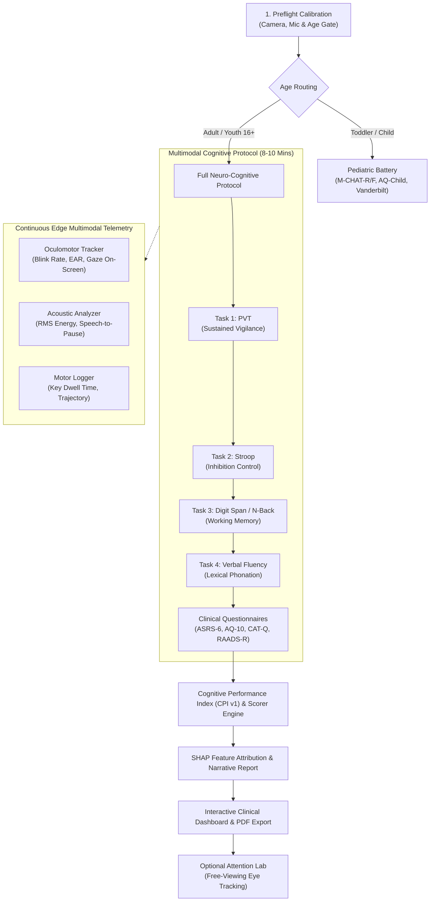
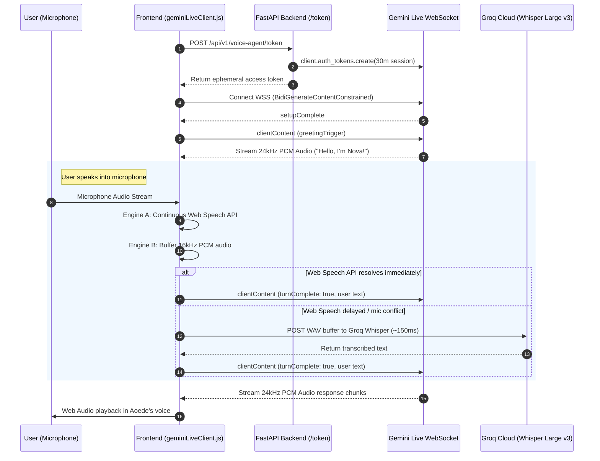

# 🧠 NeuroNova — Complete Project Summary & Viva Defense Guide

> **Project Title:** NeuroNova — Multimodal Cognitive Screening & Clinical Neuro-Analytics Platform  
> **Target Audience:** Project Team, Clinicians, Researchers, External Examiners & Technical Viva Committees  
> **Last Updated:** October 2026 | Production Build Ready

---

## 📋 Table of Contents
1. [Executive Summary & Core Objectives](#1-executive-summary--core-objectives)
2. [End-to-End System Workflow](#2-end-to-end-system-workflow)
3. [Psychometric Testing Batteries (Scientific Foundations)](#3-psychometric-testing-batteries-scientific-foundations)
4. [Multimodal Edge Sensing (Vision, Audio & Motor Engine)](#4-multimodal-edge-sensing-vision-audio--motor-engine)
5. [Complete Technical Stack Breakdown](#5-complete-technical-stack-breakdown)
6. [AI, LLM & Live Calling Infrastructure (Nova)](#6-ai-llm--live-calling-infrastructure-nova)
7. [Explainable AI (XAI) & Cognitive Performance Index (CPI)](#7-explainable-ai-xai--cognitive-performance-index-cpi)
8. [Security, Privacy & Copyright Compliance Architecture](#8-security-privacy--copyright-compliance-architecture)
9. [External Examiner Viva Q&A Bible (Top 15 Questions & Answers)](#9-external-examiner-viva-qa-bible-top-15-questions--answers)

---

## 1. Executive Summary & Core Objectives

### The Problem
Traditional cognitive assessments and neurodevelopmental evaluations (for Autism Spectrum Condition, ADHD, and AuDHD) face massive systemic barriers:
* **Waitlists:** Clinical diagnostic waitlists exceed 12 to 24 months globally.
* **Cost & Access:** Comprehensive neuropsychological evaluations cost upwards of \$2,500–\$5,000.
* **Subjective Bias:** Standard evaluations rely almost entirely on subjective, retrospective self-report questionnaires, which are vulnerable to recall bias, masking (compensation strategies), and clinical subjectivity.
* **Lack of Multimodal Biomarkers:** Existing digital tools test only clicking or surveys in isolation, failing to capture concurrent physiological markers like micro-saccades, spontaneous blinks, speech hesitation, or neuromotor tremors.

### The Solution: NeuroNova
**NeuroNova** is an end-to-end digital screening and clinical analytics system that combines:
1. **Zero-Latency Psychomotor & Cognitive Paradigms:** Millisecond-accurate reaction time, executive inhibition, working memory, and lexical fluency testing.
2. **On-Device Edge Multimodal Sensing:** Real-time oculomotor gaze tracking, acoustic phonation analysis, and neuromotor kinetics calculated locally in the browser without streaming video or audio to any server.
3. **Standardized Cognitive Performance Index (CPI v1):** Standardized normative composite ($Mean = 75.0, SD = 12.0$) across four cognitive domains.
4. **Explainable AI (SHAP):** TreeExplainer local attribution showing exact biomarker contributions toward risk indices.
5. **Nova Multimodal Live Calling Agent:** Low-latency conversational companion powered by Google Gemini Live WebSocket streaming and Groq Whisper.

---

## 2. End-to-End System Workflow

---

## 3. Psychometric Testing Batteries (Scientific Foundations)

Each task is built on peer-reviewed neuropsychological literature:

### 1. Psychomotor Vigilance Task (PVT) — *Dinges & Powell (1985)*
* **Domain:** Sustained attention, tonic alertness, and cognitive processing velocity.
* **Mechanism:** Millisecond visual stimulus presented at randomized inter-stimulus intervals (2000ms–5000ms).
* **Key Metrics:**
  * **Mean RT (ms):** General processing speed.
  * **Lapses ($\text{RT} > 500\text{ms}$):** Micro-sleeps or severe lapses in sustained vigilance (characteristic of ADHD attention fluctuation).
  * **False Starts / Premature Responses ($\text{RT} < 100\text{ms}$):** Impulsivity and motor disinhibition.
  * **Reciprocal RT ($1/\text{RT}$):** Mitigates skewness in reaction time distributions.

### 2. Dual-Rule Stroop Task — *Stroop (1935); MacLeod (1991)*
* **Domain:** Prefrontal executive inhibition, selective attention, and cognitive flexibility.
* **Mechanism:** Words displayed in matching (congruent) or conflicting (incongruent) font colors (e.g., the word "RED" written in blue ink). Uses an **adaptive staircase** that increases difficulty when performance is accurate.
* **Key Metrics:**
  * **Interference Cost ($\text{RT}_{\text{incongruent}} - \text{RT}_{\text{congruent}}$):** Time required by the anterior cingulate cortex to suppress automatic reading.
  * **Inhibition Accuracy (%):** Error rate under cognitive conflict.

### 3. Digit Span & N-Back Working Memory — *Kirchner (1958); Miller (1956)*
* **Domain:** Phonological loop capacity, active working memory updating, and maintenance.
* **Mechanism:** Serial visual digit sequences with progressive span expansion, followed by 2-back continuous matching.
* **Key Metrics:**
  * **Forward/Reverse Span Length:** Working memory buffer capacity (normative: $7 \pm 2$).
  * **$d'$ (Signal Detection Sensitivity Index):** Separates true memory recognition from random guessing:
    $$d' = Z(\text{Hit Rate}) - Z(\text{False Alarm Rate})$$

### 4. Verbal Semantic Fluency & Phonation — *Benton (1968)*
* **Domain:** Lexical retrieval, semantic clustering, and acoustic phonation dynamics.
* **Mechanism:** 25-second animal naming test with speech capture.
* **Key Metrics:**
  * **Word Retrieval Rate:** Total unique category words retrieved per minute.
  * **Phonation Pause Ratio:** Hesitation and cognitive search latency between articulated clusters.

---

## 4. Multimodal Edge Sensing (Vision, Audio & Motor Engine)

NeuroNova’s defining architectural strength is **Zero Raw Data Transmission**: raw camera video and continuous audio recordings **never leave the user's browser**.

### A. Oculomotor Tracking Engine (`useGazeTracker.js`)
* **Underlying Model:** Google `@mediapipe/tasks-vision 1.0.1` FaceLandmarker executed client-side via WebAssembly (`WASM`) with automated GPU WebGL / CPU fallback.
* **478 3D Facial Landmarks:**
  * **Adaptive Eye Aspect Ratio (EAR):**
    $$EAR = \frac{\|p_{159} - p_{145}\|}{\|p_{33} - p_{133}\|} \quad (\text{left}) \quad \text{and} \quad \frac{\|p_{386} - p_{374}\|}{\|p_{362} - p_{263}\|} \quad (\text{right})$$
    Unlike static systems, NeuroNova computes a personal baseline $EAR_{\text{base}}$ to prevent false locks on different eye shapes, epicanthic folds, or glasses. A blink triggers when $EAR < 0.68 \cdot EAR_{\text{base}}$ or blendshape score $> 0.32$.
  * **Face Blendshapes:** Real-time ARKit blendshapes (`eyeBlinkLeft`, `eyeBlinkRight`).
  * **Optical Temporal Differencing Co-Processor:** Off-screen $160 \times 120$ canvas monitors frame-to-frame pixel derivative spikes across the ocular region as a zero-delay hardware fallback.
  * **Gaze Fixation & Head Pose:** Computes head yaw and pitch variance ($^{\circ}/\text{sec}$) and iris dispersion to determine screen engagement vs. visual distraction.

### B. Acoustic Phonation Profiling (`useAcousticAnalyzer.js`)
* **Audio Engine:** Native browser `AudioContext` and `AnalyserNode` performing real-time Fast Fourier Transform (FFT).
* **Metrics:** RMS energy stability, silence-to-speech ratio, vocal jitter, and response latency.

### C. Neuromotor Kinetics (`useMotorLogger.js`)
* **Metrics:** Sub-millisecond physical keydown dwell times, keyup release latencies, and mouse trajectory curvature (motor tremor / hesitation).

---

## 5. Complete Technical Stack Breakdown

| Layer | Technology | Version | Purpose in NeuroNova |
| :--- | :--- | :--- | :--- |
| **Frontend Framework** | **React** | `19.2.8` | High-performance component lifecycle, concurrent UI rendering |
| **Build Tooling** | **Vite** | `8.3.1` | Ultra-fast ES module development & sub-350ms production builds |
| **Styling & Design** | **Tailwind CSS** | `v4` | Material Design 3 tokens, dark/light theme switching, clinical layout |
| **Computer Vision** | **MediaPipe Tasks Vision** | `1.0.1` | WASM/GPU client-side FaceLandmarker & 3D mesh analysis |
| **Audio Processing** | **Web Audio API** | Native | `AnalyserNode`, `ScriptProcessorNode`, 24kHz PCM jitter buffering |
| **Data Visualization** | **Recharts** | `3.10.1` | Radar charts, domain percentile curves, violin distribution plots |
| **Backend Framework** | **FastAPI** | `0.110.0+` | High-throughput asynchronous REST API & WebSocket proxying |
| **ASGI Server** | **Uvicorn** | `0.28.0+` | Python asynchronous event loop server |
| **Data Validation** | **Pydantic v2** | `2.6.0+` | Strict schema coercion and clinical payload validation |
| **Machine Learning** | **Scikit-Learn & NumPy**| `1.4.0+` | Normative standardization and statistical distribution fitting |
| **Explainable AI (XAI)**| **SHAP** | `0.44.0+` | TreeExplainer calculating game-theoretic Shapley feature attributions |
| **Speech-to-Text (STT)**| **Groq Whisper** | `whisper-large-v3` | 150ms speech transcription fallback & animal fluency task |
| **Live Audio Agent** | **Google Gemini Live** | `gemini-3.8-live` | Real-time bidirectional WebSocket calling in Aoede's voice |
| **Database (Opt-In)** | **Supabase (PostgreSQL)** | Client v2 | Encrypted persistence layer with Row-Level Security (RLS) |
| **Cryptography** | **Python Cryptography** | `42.0+` | PBKDF2-HMAC-SHA256, AES-GCM field encryption at rest |

---

## 6. AI, LLM & Live Calling Infrastructure (Nova)

### How Nova's Live Voice Call Operates
Nova is a conversational agent for Autism and ADHD support. It operates like a natural phone call with **zero perceptible latency**:

### Key Technical Innovations in Live Calling:
1. **Ephemeral Token Pre-allocation:** The backend pre-allocates short-lived session tokens (`new_session_expire_time = 30 minutes`), eliminating start-of-call connection delays and keeping master API keys 100% off client code.
2. **Dual-Engine Speech Recognition:** Combines native Web Speech API (zero cost, zero latency) with Groq Whisper Cloud API (150ms roundtrip fallback). If local browser speech encounters a mic collision, Groq transcribes the speech buffer seamlessly.
3. **Acoustic Echo & Barge-In Filter:** While Nova is speaking, microphone input is monitored. If the user intentionally speaks over Nova ($RMS \ge 36$), Nova halts playback immediately (barge-in).
4. **Jitter-Buffered 24kHz Scheduler:** Gemini streams 24,000 Hz 16-bit PCM chunks. A Web Audio buffer queue schedules audio seamlessly on the hardware clock, preventing pops or stutter.

---

## 7. Explainable AI (XAI) & Cognitive Performance Index (CPI)

### The Cognitive Performance Index (CPI v1)
The CPI is a standardized composite score (0–100 scale, Population $Mean = 75.0, SD = 12.0$) measuring functional cognitive capacity:
$$\text{CPI} = \sum_{i=1}^{4} w_i \cdot Z_i$$
Where $Z_i$ represents the standardized score across:
1. **Sustained Attention & Vigilance (PVT):** 35% weight
2. **Executive Inhibition Control (Stroop):** 25% weight
3. **Working Memory & Updating (Digit Span / N-Back):** 25% weight
4. **Lexical Retrieval & Phonation (Verbal Fluency):** 15% weight

### Why SHAP (SHapley Additive exPlanations)?
* In clinical AI, black-box predictions are **unacceptable**. Clinicians must know *why* an index was flagged.
* NeuroNova employs a **SHAP TreeExplainer** (`shap.TreeExplainer`) on the backend.
* It calculates the exact game-theoretic marginal contribution ($\phi_j$) of each biomarker:
  $$\text{Score} = \text{Base Value} + \sum_{j=1}^{M} \phi_j$$
* The dashboard visualizes this as a waterfall feature attribution chart: showing whether reaction time lapses, blink rate, or Stroop interference contributed most to the executive function score.

---

## 8. Security, Privacy & Copyright Compliance Architecture

### 1. Anonymous Ephemeral Mode by Default
* `PERSISTENCE_ENABLED=false` by default. Health data is **never written to disk** unless an authorized clinician explicitly configures a database.
* All processing occurs in volatile client memory and is wiped on page reload.

### 2. Regulatory Compliance
* **HIPAA § 164.312(b) Audit Trail:** When persistence is active, every database access, assessment read, export, or deletion is recorded in an immutable append-only audit log.
* **COPPA Minor Protections:** Minors under 13 cannot be evaluated without verified parental consent (`parental_consent_verified: true`). Only pseudonymous IDs (e.g., `NN-2025-482B`) are stored; zero Personally Identifiable Information (PII) is accepted.
* **GDPR Article 17 & 20:**
  * Complete Right-to-Erasure via `DELETE /api/v1/patients/{id}`.
  * Machine-readable Data Portability export via `GET /api/v1/patients/{id}/export`.
* **Field-Level Encryption at Rest:** Clinical notes are encrypted using PBKDF2-HMAC-SHA256 derived keys and AES-GCM authenticated ciphertexts with unique IVs.

### 3. Copyright Architecture (Zero-Code Dynamic Text Loading)
* Proprietary clinical questionnaires (M-CHAT-R/F, AQ-Child, RAADS-R, AQ-50, RBQ-2A, Vanderbilt) are protected intellectual property.
* **Architecture:** No copyrighted question text is committed to the Git repository. The code contains masked placeholders.
* Licensed institutions supply official questions on-the-fly via JSON or CSV file upload through the UI (`textLoader.js`), dynamically hydrating the assessment without code changes.
* Build pipeline enforces copyright safety via automated auditing: `npm run check:licensing`.

---

## 9. External Examiner Viva Q&A Bible (Top 15 Questions & Answers)

### Q1: How do you ensure millisecond-accurate reaction timing in a web browser, given JavaScript's single-threaded nature?
> **Answer:** We bypass standard `Date.now()` (which has millisecond jitter and is subject to OS clock adjustments) and strictly utilize `performance.now()`, which provides sub-millisecond timestamps based on a monotonic hardware clock. Furthermore, all stimulus rendering events are synchronized directly to the browser's hardware refresh cycle using `requestAnimationFrame()`, minimizing input lag and frame dropping.

---

### Q2: Why did you implement eye tracking on the client edge instead of sending video to a cloud server?
> **Answer:** There are two fundamental reasons:
> 1. **Privacy & HIPAA Compliance:** Facial webcam video is biometric personally identifiable information (PII). Streaming patient faces to a cloud server creates severe compliance vulnerabilities and requires patient biometric data agreements. By processing video client-side via MediaPipe WASM, raw video never touches a server or disk; only sanitized floating-point numbers (e.g., blink rate = 18.2) are transmitted.
> 2. **Network Latency & Bandwidth:** Video streaming requires high bandwidth and introduces unpredictable network jitter. Edge processing runs consistently at 30 FPS locally regardless of internet speed.

---

### Q3: What is the Eye Aspect Ratio (EAR), and how does your adaptive baseline prevent false blink detection?
> **Answer:** EAR measures the ratio of the vertical distance between eyelids to the horizontal width between eye corners:
> $$EAR = \frac{\|p_{\text{upper}} - p_{\text{lower}}\|}{\|p_{\text{left}} - p_{\text{right}}\|}$$
> Standard algorithms use a static threshold (e.g., $EAR < 0.20$), which fails for individuals with naturally narrower eyes, epicanthic folds, or glasses (causing the tracker to get stuck in a permanent blink state). NeuroNova continuously calculates an exponential moving average personal baseline ($EAR_{\text{base}}$). A blink is detected only when EAR drops $\ge 32\%$ below their personal baseline, combined with facial blendshape verification.

---

### Q4: How is the Cognitive Performance Index (CPI) calculated and standardized?
> **Answer:** The CPI is a standardized normative composite score ($Mean = 75.0, SD = 12.0$). Raw scores across our four psychometric paradigms (PVT lapses, Stroop interference cost, working memory span length, and verbal fluency rate) are transformed into standard $Z$-scores based on age-stratified normative distributions. These are weighted (35% attention, 25% inhibition, 25% memory, 15% verbal) and mapped onto a 0–100 Gaussian scale, allowing clinicians to instantly interpret overall functional capacity.

---

### Q5: What is SHAP, and why is it necessary for a clinical decision support system?
> **Answer:** Machine learning models often act as "black boxes," which makes them unacceptable in healthcare because clinicians cannot verify the reasoning behind an alert. SHAP (SHapley Additive exPlanations) is based on cooperative game theory. It calculates the exact Shapley value for every feature—quantifying precisely how much each millisecond of reaction time lapse or decrease in blink rate increased or decreased the patient's risk index relative to the population baseline.

---

### Q6: How does your Gemini Live Voice Agent achieve low latency without freezing?
> **Answer:** We implemented a 4-tier calling architecture:
> 1. **WebSockets:** We use bidirectional streaming WebSockets (`BidiGenerateContentConstrained`) instead of standard REST HTTP request-response cycles.
> 2. **Ephemeral Auth Tokens:** Tokens are pre-generated on the backend with 30-minute session limits, removing authentication handshakes at call time.
> 3. **Dual-Engine Speech Recognition:** Browser Web Speech API provides zero-latency local speech-to-text, backed by a 150ms Groq Whisper fallback if audio device collisions occur.
> 4. **Jitter Buffering:** Model output is received as 24kHz raw PCM and scheduled directly on the Web Audio timeline clock.

---

### Q7: What happens if the internet goes down during an assessment?
> **Answer:** All four core psychometric paradigms (PVT, Stroop, Digit Span, Verbal Fluency) and all clinical questionnaires run 100% client-side in the browser. In the event of a total network disconnect, the patient can complete the entire assessment battery without interruption. Sensor telemetry and test scores are preserved in local memory, and reports are rendered using client-side clinical heuristics.

---

### Q8: How did you handle intellectual property and copyright on proprietary clinical screeners like M-CHAT or RAADS-R?
> **Answer:** We implemented a **Zero-Code Dynamic Text Loading** architecture (`textLoader.js`). No proprietary, copyrighted questionnaire text is stored in our code repository. Instead, the code holds clear placeholder masks. Licensed clinical institutions simply upload their authorized item bundle as a JSON or CSV file through the UI, which hydrates the instrument dynamically into memory without requiring code changes. Our CI build pipeline enforces this with an automated check (`npm run check:licensing`).

---

### Q9: Why use Groq Whisper when Gemini can already process multimodal audio?
> **Answer:** Groq utilizes Language Processing Units (LPUs) that run Whisper Large v3 at over 300 words per second, delivering sub-150ms transcription latency. While Gemini handles the generative conversational dialogue, offloading rapid phonetic transcription to Groq provides a reliable fallback for multi-accented speech and lexical fluency scoring without overloading the live calling socket.

---

### Q10: How do you differentiate between Autism and ADHD in your assessment outputs?
> **Answer:** While Autism and ADHD frequently co-occur (AuDHD), their biomarker profiles diverge:
> * **ADHD Indicators:** Elevated PVT reaction time variability, frequent micro-lapses ($>500\text{ms}$), high premature false starts, elevated Stroop interference cost, and high head yaw/pitch motor variance.
> * **Autism Indicators:** Elevated sensory sensitivity scores, high CAT-Q camouflaging and masking indices, repetitive behavioral indicators (RBQ-2A), distinct semantic clustering pauses during verbal fluency, and characteristic gaze fixation dispersion.

---

### Q11: How do you ensure COPPA compliance when screening toddlers and pediatric patients?
> **Answer:** Under the Children's Online Privacy Protection Act (COPPA), capturing data from children under 13 requires verified parental consent. NeuroNova enforces an explicit parental gate (`AgeGateModal` and `parental_consent_verified: true`) before any pediatric module (such as M-CHAT-R/F or Vanderbilt) can initialize. Furthermore, only pseudonymous generated IDs are assigned—no names, emails, or personal identifiers are stored.

---

### Q12: Why did you eliminate `sessions_cache.json` and switch to an abstract database adapter?
> **Answer:** Storing health data in a plaintext JSON file on a local filesystem is a critical security vulnerability that violates HIPAA and GDPR. We replaced it with `BaseScreeningRepository`—an abstract repository pattern. By default, data is ephemeral in memory only (`PERSISTENCE_ENABLED=false`). When persistence is enabled, it routes through an encrypted adapter (Supabase PostgreSQL with Row-Level Security) featuring field-level AES-GCM encryption.

---

### Q13: What is the significance of the 25-second Verbal Fluency Task?
> **Answer:** Category verbal fluency (animal naming) tests semantic memory access, lexical retrieval, and executive search strategies in the temporal and frontal lobes. NeuroNova automatically transcribes the audio, deduplicates words, cross-references with a semantic taxonomy of over 100 animal taxa, and calculates the temporal pause ratio between word bursts to detect word-finding hesitations.

---

### Q14: How does the system handle "masking" or "camouflaging" often seen in adult neurodivergent females?
> **Answer:** Adult females with Autism or AuDHD often consciously mask their symptoms, scoring deceptively low on classical observational tests. NeuroNova integrates the **CAT-Q (Camouflaging Autistic Traits Questionnaire)**, which specifically quantifies Compensation, Masking, and Assimilation. Combined with objective oculomotor and reaction time metrics that cannot be consciously faked, it provides clinicians with a composite view.

---

### Q15: Why is the backend built with FastAPI instead of Django or Flask?
> **Answer:** FastAPI is built natively on asynchronous Python (ASGI via Uvicorn and Starlette). Cognitive telemetry involves streaming concurrent sensor arrays and real-time WebSocket requests. FastAPI provides asynchronous non-blocking I/O, native Pydantic v2 data validation, and automated OpenAPI documentation, outperforming synchronous frameworks like Flask or Django in high-concurrency microservice environments.

---

### 🎓 Summary Sheet for Viva Quick-Revision

| Metric / Parameter | Value / Implementation |
| :--- | :--- |
| **Monotonic Clock** | `window.performance.now()` (Sub-millisecond resolution) |
| **Camera Vision FPS** | 30 FPS throttled locally via `requestAnimationFrame` |
| **Landmark Count** | 478 3D facial coordinate points |
| **Audio Downlink** | 24,000 Hz 16-bit Mono PCM (Gemini Live) |
| **Audio Uplink STT** | 16,000 Hz Mono WAV (Groq Whisper Large v3) |
| **Normative Composite** | CPI v1 ($Mean = 75.0, SD = 12.0$) |
| **Explainable AI** | SHAP (`TreeExplainer` game-theoretic attribution) |
| **Encryption Standard**| PBKDF2-HMAC-SHA256 & AES-GCM Authenticated Encryption |
| **Privacy Default** | Anonymous ephemeral in-memory (Zero disk storage) |
| **Supported Languages**| English (`en`), Hindi (`hi`), Marathi (`mr`) |

